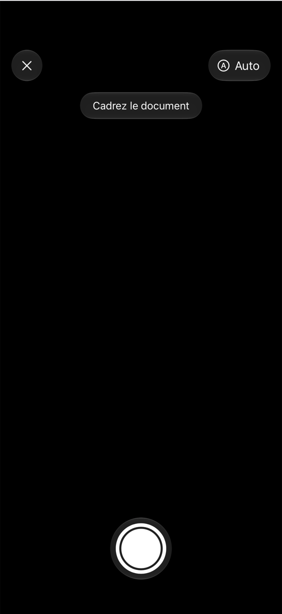
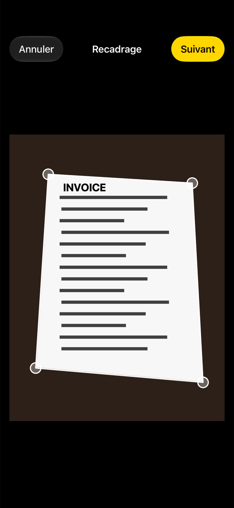
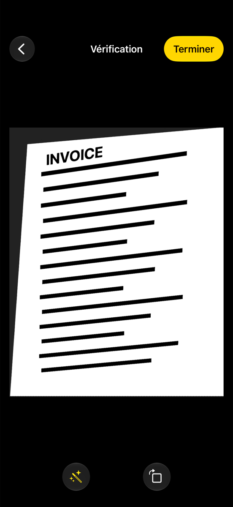

# MBDocCapture

[](https://swift.org)
[](https://developer.apple.com/ios/)
[](https://swift.org/package-manager/)
[](LICENSE)

**MBDocCapture** adds a polished document scanner to your iOS app: live edge detection, auto capture, corner adjustment with a magnifier, perspective correction and a black & white "enhanced" filter. It ships with a **Liquid Glass** interface on iOS 26+, falls back gracefully to material blur on older systems, and almost every detail can be customized.

<p align="center">
  
  
  
</p>

- [Features](#features)
- [Requirements](#requirements)
- [Installation](#installation)
- [Quick start](#quick-start) — [UIKit](#uikit) · [SwiftUI](#swiftui) · [async/await](#asyncawait) · [Closures](#closures)
- [Two-sided documents](#two-sided-documents)
- [Cropping an existing photo](#cropping-an-existing-photo)
- [Customization](#customization)
- [Results](#results)
- [Errors](#errors)
- [Localization](#localization)
- [Example app](#example-app)
- [Migrating from 0.x](#migrating-from-0x)
- [Documentation](#documentation)

## Features

- 📄 Live rectangle detection with a stabilizing funnel (no jittery outlines)
- ⚡️ Auto scan when the document is stable, or manual shutter — switchable on screen
- ✂️ Corner adjustment with a magnifying loupe
- 🪄 Perspective correction + black & white enhancement
- 🔄 Rotation on the review screen
- 🪪 Front & back scanning (ID cards, cheques…)
- 🔦 Flashlight, tap to focus, haptics
- 🫧 Liquid Glass on iOS 26+, material blur fallback on iOS 15–18
- 🎨 Colors, sizes, icons, texts, steps, detection thresholds: all configurable
- 🧩 UIKit delegate, closures, `async/await` and SwiftUI APIs
- 🌍 English & French built in, every string overridable

## Requirements

| | Minimum |
|---|---|
| iOS | 15.0 (Liquid Glass from iOS 26) |
| Xcode | 16 (Xcode 26+ to get Liquid Glass) |
| Swift | 5.9 |

Add the camera usage description to your app's `Info.plist`:

```xml
<key>NSCameraUsageDescription</key>
<string>The camera is used to scan documents.</string>
```

## Installation

### Swift Package Manager

In Xcode: **File ▸ Add Package Dependencies…** and enter:

```
https://github.com/iMhdi/MBDocCapture.git
```

Or in `Package.swift`:

```swift
dependencies: [
    .package(url: "https://github.com/iMhdi/MBDocCapture.git", from: "1.0.0")
],
targets: [
    .target(name: "YourApp", dependencies: ["MBDocCapture"])
]
```

> CocoaPods is no longer supported starting with 1.0 (the CocoaPods trunk is becoming read-only). Use 0.1.x if you are stuck on CocoaPods.

## Quick start

### UIKit

```swift
import MBDocCapture

final class ViewController: UIViewController, ImageScannerControllerDelegate {

    @IBAction func scan() {
        let scanner = ImageScannerController(delegate: self)
        present(scanner, animated: true)
    }

    func imageScannerController(_ scanner: ImageScannerController, didFinishScanningWithResults results: ImageScannerResults) {
        imageView.image = results.preferredImage
        scanner.dismiss(animated: true)
    }

    func imageScannerControllerDidCancel(_ scanner: ImageScannerController) {
        scanner.dismiss(animated: true)
    }

    func imageScannerController(_ scanner: ImageScannerController, didFailWithError error: Error) {
        scanner.dismiss(animated: true)
        print(error.localizedDescription)
    }
}
```

The delegate is responsible for dismissing the scanner.

### SwiftUI

```swift
import SwiftUI
import MBDocCapture

struct ContentView: View {
    @State private var isScanning = false
    @State private var pages: [ImageScannerResults] = []

    var body: some View {
        Button("Scan a document") { isScanning = true }
            .documentScanner(isPresented: $isScanning) { result in
                switch result {
                case .success(let pages): self.pages = pages
                case .failure(is CancellationError): break       // user cancelled
                case .failure(let error): print(error.localizedDescription)
                }
            }
    }
}
```

`documentScanner(isPresented:image:configuration:onCompletion:)` presents the scanner full screen and dismisses it for you. Need more control over presentation? Use the `DocumentScanner` view directly.

### async/await

```swift
do {
    let pages = try await ImageScannerController.scan(from: self)
    imageView.image = pages[0].preferredImage
} catch is CancellationError {
    // user cancelled
} catch {
    print(error.localizedDescription)
}
```

### Closures

```swift
let scanner = ImageScannerController(configuration: configuration) { result in
    // the scanner has already dismissed itself here
    if case .success(let pages) = result { save(pages) }
}
present(scanner, animated: true)
```

## Two-sided documents

```swift
var configuration = MBDocCaptureConfiguration()
configuration.behavior.scanMode = .twoSided
```

After the front is validated, the user is asked to flip the document. Results arrive through `imageScannerController(_:didFinishScanningWithPage1Results:andPage2Results:)` — or as a two-element array with the SwiftUI, closure and async APIs.

## Cropping an existing photo

Pass an image to skip the camera and start at the corner adjustment step. The document is detected automatically when possible.

```swift
let scanner = ImageScannerController(image: photo, delegate: self)
```

## Customization

Everything lives in `MBDocCaptureConfiguration`, split in four groups. Start from the defaults and change only what you need:

```swift
var configuration = MBDocCaptureConfiguration()

// Look
configuration.appearance.tintColor = .systemPink
configuration.appearance.detectionStrokeColor = .systemPink
configuration.appearance.detectionFillColor = .systemPink.withAlphaComponent(0.2)
configuration.appearance.usesLiquidGlass = true

// Behavior
configuration.behavior.isAutoScanEnabled = false
configuration.behavior.showsReviewStep = false

// Detection
configuration.detection.autoScanStabilityFrames = 20

// Texts
configuration.strings.hintSearching = "Show me a receipt"

let scanner = ImageScannerController(configuration: configuration, delegate: self)
```

### Appearance

| Property | Default | Description |
|---|---|---|
| `usesLiquidGlass` | `true` | Liquid Glass controls on iOS 26+. `false` (or older iOS) uses material blur. |
| `interfaceStyle` | `.dark` | Interface style forced on the scanner. `.unspecified` follows the system. |
| `tintColor` | `.systemYellow` | Accent: active toggles, Next/Done buttons. |
| `controlForegroundColor` | `.white` | Icons and labels on glass controls. |
| `backgroundColor` | `.black` | Behind the preview and images. |
| `detectionStrokeColor` | `.white` | Outline of the live detected document. |
| `detectionFillColor` | white 25 % | Fill of the live detected document. |
| `detectionLineWidth` | `2` | Outline width, in points. |
| `editStrokeColor` | `.white` | Outline on the adjust screen. |
| `editMaskColor` | black 60 % | Dimming outside the document on the adjust screen. |
| `cornerHandleColor` | `.white` | Corner handles. |
| `cornerHandleSize` | `22` | Corner handle diameter. |
| `magnifierSize` | `96` | Loupe diameter while dragging a corner. |
| `magnifierZoom` | `2.5` | Loupe zoom factor. |
| `focusIndicatorColor` | `.systemYellow` | Tap-to-focus square. |
| `shutterButtonColor` | `.white` | Shutter. |
| `shutterButtonSize` | `72` | Shutter diameter. |
| `hintFont` | `.subheadline` | Guidance hint font. |
| `icons` | SF Symbols | See below. |

#### Icons

Every button uses an SF Symbol name you can change, and you can supply your own images:

```swift
configuration.appearance.icons.cancel = "chevron.down"           // another SF Symbol
configuration.appearance.icons.custom["wand.and.stars"] = UIImage(named: "magic")  // your asset
```

Available keys: `cancel`, `torchOff`, `torchOn`, `autoScan`, `manualScan`, `enhance`, `rotate`, `flip`.

### Behavior

| Property | Default | Description |
|---|---|---|
| `scanMode` | `.singlePage` | `.twoSided` scans front and back. |
| `isAutoScanEnabled` | `true` | Auto capture state when the scanner opens. |
| `showsAutoScanToggle` | `true` | Auto / Manual button. |
| `showsTorchButton` | `true` | Flashlight button (hidden on devices without torch). |
| `showsHints` | `true` | "Position the document in view", "Hold still…". |
| `isTapToFocusEnabled` | `true` | Tap the preview to focus. |
| `isHapticFeedbackEnabled` | `true` | Haptics on capture, toggles and corner drag. |
| `showsEditStep` | `true` | `false` uses the detected rectangle (or the full image) as is. |
| `showsReviewStep` | `true` | `false` delivers results right after the edit step. |
| `isEnhancementAvailable` | `true` | Computes and offers the black & white version. |
| `prefersEnhancedImageByDefault` | `false` | Enhanced version selected by default. |
| `isRotationAvailable` | `true` | Rotate button on the review screen. |
| `allowsSwipeToDismiss` | `false` | Allows swiping the scanner away when presented as a sheet. |

> With both `showsEditStep` and `showsReviewStep` set to `false`, the scanner captures and returns in one tap — a "one-shot" scanner.

The scanner is presented full screen by default. Set `scanner.modalPresentationStyle` before presenting for another style.

### Detection

| Property | Default | Description |
|---|---|---|
| `autoScanStabilityFrames` | `35` | Stable frames before auto capture. Lower = faster. |
| `autoScanPrecision` | `6` | Max corner movement (px) for a frame to count as stable. |
| `matchingThreshold` | `40` | Distance (px) under which two detections are the same document. |
| `enhancementRange` | `0.25...0.75` | Luminance below → black, above → white. |

### Strings

All texts are in `configuration.strings`: `cancel`, `next`, `done`, `editTitle`, `reviewTitle`, `flipPrompt`, `hintSearching`, `hintHoldStill`, `hintManual`, `autoScanOn`, `autoScanOff`, `torch`, `shutter`, `enhance`, `rotate`. The last five are also used as VoiceOver labels.

## Results

`ImageScannerResults` gives you:

| Property | Description |
|---|---|
| `preferredImage` | What the user picked: enhanced or not. Use this in most cases. |
| `scannedImage` | Cropped and deskewed, in color. |
| `enhancedImage` | Black & white version (`nil` if enhancement is off). Handy for OCR. |
| `originalImage` | The full photo before cropping. |
| `doesUserPreferEnhancedImage` | The user's choice on the review screen. |
| `detectedRectangle` | The four corners used for the crop, in `originalImage` coordinates. |

## Errors

`ImageScannerControllerError`:

| Case | When |
|---|---|
| `.authorization` | Camera access denied. Invite the user to open Settings. |
| `.inputDevice` | No usable camera (e.g. the Simulator). |
| `.capture` | The photo could not be captured. |
| `.ciImageCreation` | The image could not be processed. |

Cancelling is not an error with the delegate API (`imageScannerControllerDidCancel`); it is a `CancellationError` with the SwiftUI, closure and async APIs.

## Localization

English and French are bundled and picked automatically. For another language, or different wording, set `configuration.strings`:

```swift
configuration.strings.cancel = NSLocalizedString("scanner.cancel", comment: "")
```

## Example app

`Example/` contains a SwiftUI playground that exposes most options live. Open `Example/MBDocCaptureExample.xcworkspace` and run. The Simulator has no camera: use **Crop a Photo** there, or run on a device.

The project is generated with [Tuist](https://tuist.io) from `Example/Project.swift` (run `tuist generate` after editing it), and the generated project is committed so you don't need Tuist to try it.

## Migrating from 0.x

| 0.x | 1.0 |
|---|---|
| CocoaPods | Swift Package Manager |
| iOS 10, Swift 4.2 | iOS 15, Swift 5.9 |
| `scanner.shouldScanTwoFaces = true` | `configuration.behavior.scanMode = .twoSided` (the old property still works) |
| `ImageScannerControllerDelegate: NSObjectProtocol` | `AnyObject`, and the two-page method is now optional |
| — | `MBDocCaptureConfiguration`, SwiftUI, async/await, closures |
| `UIColor(hexString:)` extension was public | Removed: it leaked into host apps |
| PNG icons | SF Symbols |

`ImageScannerController(delegate:)` and `ImageScannerController(image:delegate:)` keep working unchanged.

## Documentation

The full API reference and guides are a DocC catalog: in Xcode, **Product ▸ Build Documentation**.

## License

MBDocCapture is available under the MIT license. See [LICENSE](LICENSE).

## Support

If this project helped you, buy me a coffee ☕️

[](https://paypal.me/BEMahdi)
